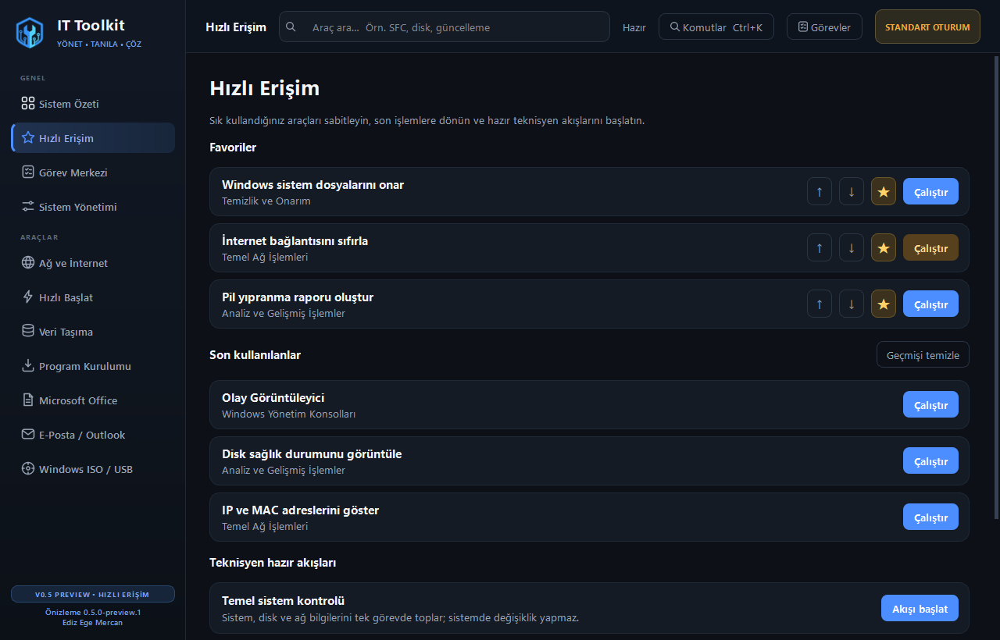

<p align="center">
  
</p>

<h1 align="center">IT Toolkit</h1>

<p align="center">
  <strong>Yönet • Tanıla • Çöz</strong><br>
  Windows 10 ve 11 için modern sistem yönetimi, tanılama ve bakım merkezi.
</p>

<p align="center">
  
  
  
  
  
</p>

<p align="center">
  <a href="https://github.com/EddizEge/IT-Toolkit/releases">İndir</a>
  ·
  <a href="ROADMAP.md">Yol Haritası</a>
  ·
  <a href="CONTRIBUTING.md">Katkıda Bulun</a>
  ·
  <a href="SECURITY.md">Güvenlik</a>
</p>



## Nedir?

IT Toolkit; teknisyenlerin, sistem yöneticilerinin ve yardım masası
ekiplerinin sık kullandığı Windows araçlarını tek, hızlı ve anlaşılır bir
arayüzde toplar. Yerleşik Windows komutlarını, resmi üretici bağlantılarını ve
güvenli tanılama akışlarını kullanır.

Bu depo, projenin yeni **PySide6 tabanlı temiz sürümünü** içerir. Lisans
atlatma, korsan yazılım, parola çözme veya güvenilir olmayan indirme kaynakları
bu sürümün parçası değildir.

## Öne çıkanlar

- Modern koyu tema, özgün marka kimliği ve tutarlı SVG ikon sistemi
- Açıklanabilir 0–100 sağlık puanı ve önem seviyeli akıllı tanılama
- Disk, bellek, pil, Windows Update ve yeniden başlatma kontrolleri
- Her bulgu için yerel kanıt, güvenli öneri ve puan etkisi
- Dokuz araç modülü altında 64 işlem ve merkezi Görev Merkezi
- 32 yazılım için resmi `winget` veya üretici kaynağı
- Global araç arama ve bağlama göre gruplandırılmış işlemler
- Favoriler, kişisel sıralama ve son kullanılan araçlar
- `Ctrl+K` komut paleti ve hızlı gezinme kısayolları
- Temel kontrol, ağ onarımı ve teslim özeti hazır akışları
- Canlı CPU, RAM, disk, işletim sistemi ve donanım özeti
- Uzun işlemlerde arayüzü kilitlemeyen arka plan yürütme altyapısı
- Canlı görev çıktısı, ilerleme, iptal ve son 100 işlemlik yerel geçmiş
- PowerShell ve çok adımlı görevlerde güvenilir hata/çıkış kodu aktarımı
- Görev çıktısını panoya kopyalama ve UTF-8 rapor olarak dışa aktarma
- Yönetici yetkisi durumu ve kritik işlemler için açık uyarılar
- Windows 10/11 ile uyumlu tek dosyalık taşınabilir EXE

## Modüller

| Modül | İçerik |
| --- | --- |
| Sistem Özeti | CPU, RAM, disk, donanım, işletim sistemi ve çalışma süresi |
| Akıllı Tanılama | Sağlık puanı, önem seviyeli bulgular, kanıtlar ve güvenli öneriler |
| Hızlı Erişim | Favoriler, son kullanılanlar ve teknisyen hazır akışları |
| Görev Merkezi | Canlı çıktı, ilerleme, iptal, sonuç geçmişi ve rapor dışa aktarma |
| Sistem Yönetimi | Temizlik, onarım, yazıcı, önbellek, SMART ve geri yükleme araçları |
| Ağ ve İnternet | IP/DNS sıfırlama, bağlantı analizi, Wi-Fi QR ve ağ yardımcıları |
| Hızlı Başlat | Windows yönetim konsolları ve hızlı tanılama kısayolları |
| Veri Taşıma | Profil yedekleme, envanter, sahiplik ve disk işlemleri |
| Program Kurulumu | Resmi `winget` paketleri ve üretici destek sayfaları |
| Microsoft Office | Resmi kurulum, onarım, güvenli mod ve lisans tanılama |
| E-Posta / Outlook | Profil yönetimi, güvenli mod, arşiv ve resmi destek |
| Windows ISO / USB | Resmi Microsoft ISO, Rufus/Fido ve lisans durumu araçları |

## Mimari

```text
main_v2.py
└── app_v2/
    ├── main_window.py       # Ana pencere, menü ve klavye kısayolları
    ├── command_palette.py   # Ctrl+K araç arama ve çalıştırma paleti
    ├── pages/               # Modül ekranları
    │   └── tasks.py         # Görev Merkezi ve canlı çıktı arayüzü
    ├── services/            # Komut, tercih, ayar ve sistem izleme servisleri
    │   └── task_manager.py  # Süreç, iptal ve kalıcı geçmiş yönetimi
    ├── registry.py          # Araç ve paket tanımları
    ├── widgets.py           # Ortak arayüz bileşenleri
    ├── icons.py             # SVG ikon sistemi
    └── theme.py             # Renk, tipografi ve stil sistemi
```

Arayüz ana iş parçacığında kalır; sistem sorguları ve uzun komutlar arka
planda yürütülür. Araç tanımları merkezi kayıt yapısından sayfalara dağıtılır,
böylece yeni bir işlem eklemek veya aramada görünür yapmak kolaylaşır.
Standart görevlerin çıktısı Qt süreç altyapısıyla anlık olarak Görev Merkezi’ne
aktarılır. UAC ile ayrı yönetici penceresine devredilen görevler güvenlik sınırı
nedeniyle harici görev olarak işaretlenir.

## İndirme

Hazır Windows sürümünü
[Releases](https://github.com/EddizEge/IT-Toolkit/releases) sayfasından
indirebilirsiniz. `preview` etiketli sürümler erken test içindir ve Windows
SmartScreen, imzalanmamış EXE için uyarı gösterebilir.

## Kaynaktan çalıştırma

Gereksinimler:

- Windows 10 veya Windows 11
- Python 3.12+
- Bazı sistem işlemleri için yönetici yetkisi

```powershell
git clone https://github.com/EddizEge/IT-Toolkit.git
cd IT-Toolkit
python -m venv .venv
.\.venv\Scripts\Activate.ps1
python -m pip install -r requirements.txt
python main_v2.py
```

Alternatif olarak `Baslat_v2.bat` dosyasını çalıştırabilirsiniz.

## EXE oluşturma

```powershell
.\Derle_v2.bat
```

Derleme sonucu `dist/` klasörüne yazılır. GitHub’daki her yayın oluşturulduğunda
Windows iş akışı aynı işlemi temiz bir ortamda tekrarlar ve EXE dosyasını
Release varlığı olarak ekler.

## Sürüm politikası

Proje [SemVer](https://semver.org/) düzenini kullanır:

- `MAJOR`: Geriye uyumsuz büyük değişiklik
- `MINOR`: Yeni özellik veya modül
- `PATCH`: Hata ve güvenlik düzeltmesi
- `preview`, `beta`, `rc`: Kararlılık öncesi yayın kanalları

Planlanan kilometre taşları ve kabul ölçütleri için
[ROADMAP.md](ROADMAP.md), yayın adımları için
[RELEASING.md](RELEASING.md) dosyasına bakın.

## Güvenlik ve sorumluluk

IT Toolkit sistem ayarlarını değiştirebilen yönetim araçları içerir. Kritik
işlemlerden önce yedek alın ve açıklamayı okuyun. Güvenlik açığını herkese açık
issue olarak paylaşmadan önce [güvenlik politikasını](SECURITY.md) izleyin.

## Katkı

Hata raporları, arayüz önerileri ve güvenli yeni araç katkıları memnuniyetle
karşılanır. Başlamadan önce [CONTRIBUTING.md](CONTRIBUTING.md) belgesini okuyun.

## Marka

Logo, renkler, tipografi ve ikon kuralları
[Marka Kimliği](docs/BRAND_IDENTITY.md) belgesinde tanımlanmıştır.

## Geliştirici

**Ediz Ege Mercan** · [@EddizEge](https://github.com/EddizEge)

## Lisans

Kaynak kod şu an görünür durumdadır ancak yeniden kullanım lisansı henüz
seçilmemiştir. Ayrıntı için [LICENSE.md](LICENSE.md) dosyasına bakın.
